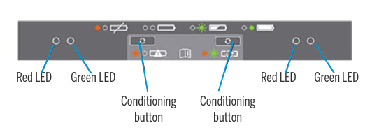
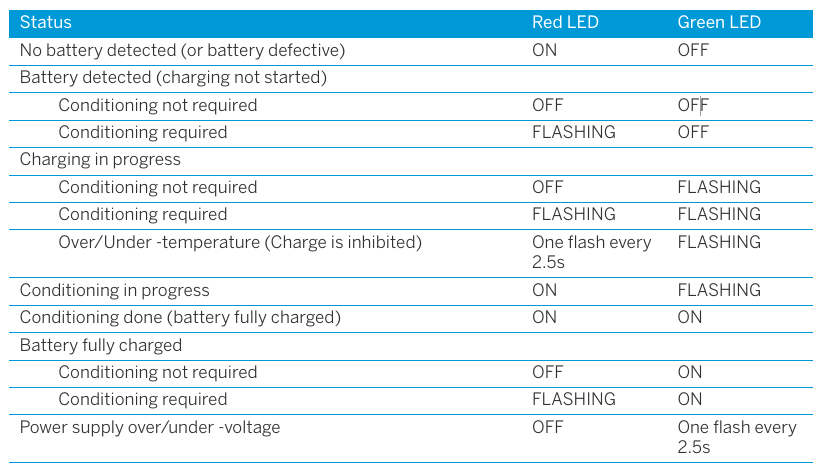
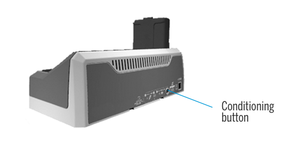

# Kwaliteitszorg

## Kalibratie

Alle acties betreffende kalibratie worden bijgehouden in het toestel registratieformulier: naam en link.

```{r kalibratie}
kalib <- data.frame(
  kalibratie = c("R^2", "Helling", "Area Blanco", "Area Standaard"),
  Criterium = "",
  Termijn = ""
)

pander::pander(kalib, split.tables = Inf)
```

## Controle

Alle acties betreffende controle worden bijgehouden in het toestel registratieformulier: naam en link.

```{r controle}
controle <- data.frame(
  Onderdeel = "",
  Controle = "",
  Criterium = "",
  Termijn = ""
)

pander::pander(controle, split.tables = Inf)
```

## Onderhoud

### TSC5

Opladen: U kunt de batterij op elk gewenst moment opladen; deze hoeft niet leeg of bijna leeg te zijn.
Het is echter raadzaam om de batterij minstens één keer per maand tot onder de 10% te laten ontladen voordat u deze weer oplaadt.
Opladen is mogelijk bij temperaturen tussen 0 °C en +40 °C.
Gebruik uitsluitend de door de fabrikant voorgeschreven oplaadaccessoires.

Touchscreen: Regelmatig schoonmaken met een vochtige vod of brillendoek, als het zeer vuil is mag je het ook onder de kraan afspoelen, mits USB poort afgesloten is.
Hou het scherm uit de zon wanneer het niet gebruikt wordt.

### Trimble S5 Totaalstation

Opladen: De batterijen hebben 4 LED lichtjes, wanneer je de knop indrukt tonen deze LEDs het batterij percentage.
Elke LED correspondeert met 25% batterij.
Bij minder dan 10% begint 1 LED te knipperen.
Wanneer alle vier de LED lichtjes knipperen na het indrukken van de knop moet de batterij geconditioneerd worden.
De batterijlader zelf heeft ook LED lichtjes, de betekenis ervan kun je in de onderstaande tabel vinden:





Conditioneren van de batterij: \
1.
Druk de conditioning button in.
De rode LED’s worden constant ipv knipperend.
Alle groene LEDs beginnen te knipperen.
Laat de knop los.
\
2.
laat de conditioning ononderbroken doorgaan.
Één batterij conditioneren duurt tot 24u, doe dit dus best over een weekend.



Bewaren: Opslag bij temperaturen tussen -40 °C en +70 °C in een droge omgeving.
Verwijder altijd de batterij voor transport en opslag.

```{r onderhoud}
onderhoud <- data.frame(
  Onderhoud = c("Extern", "Intern"),
  Handeling = "",
  Criterium = "",
  Termijn = ""
)

pander::pander(onderhoud, split.tables = Inf)
```

### Extern onderhoud

### Intern onderhoud

#### Onderhoud onderdeel

Reagentia en materiaal:

- 

- 

Handeling:

- 

- 

## Error

Alle acties betreffende `ERROR` worden bijgehouden in het toestel registratieformulier: naam en link.
